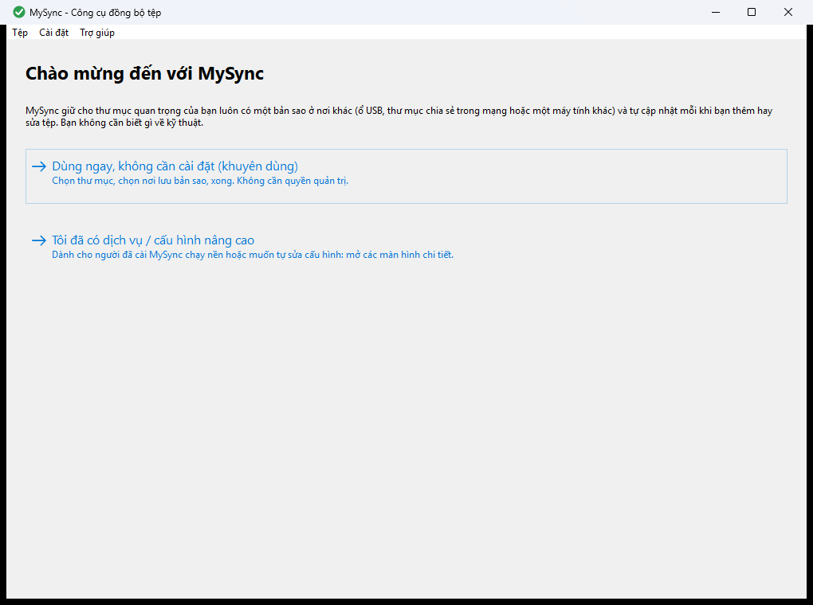
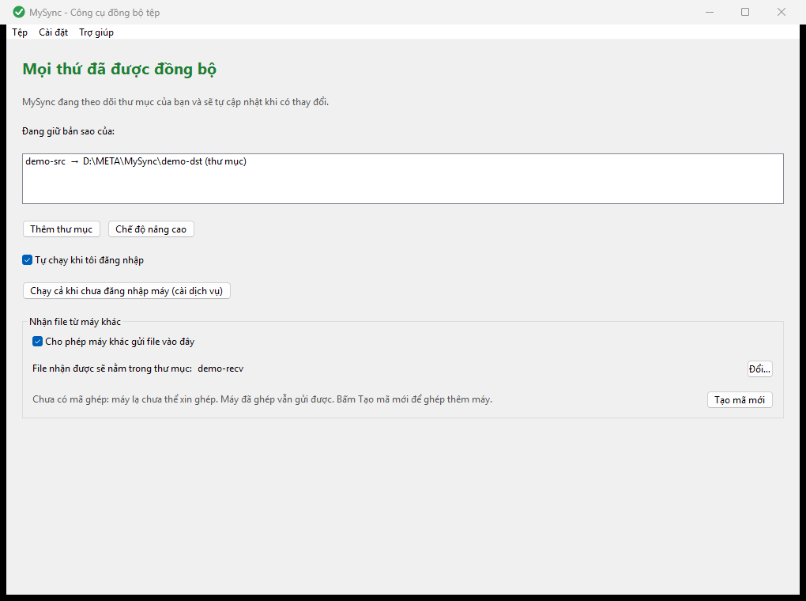
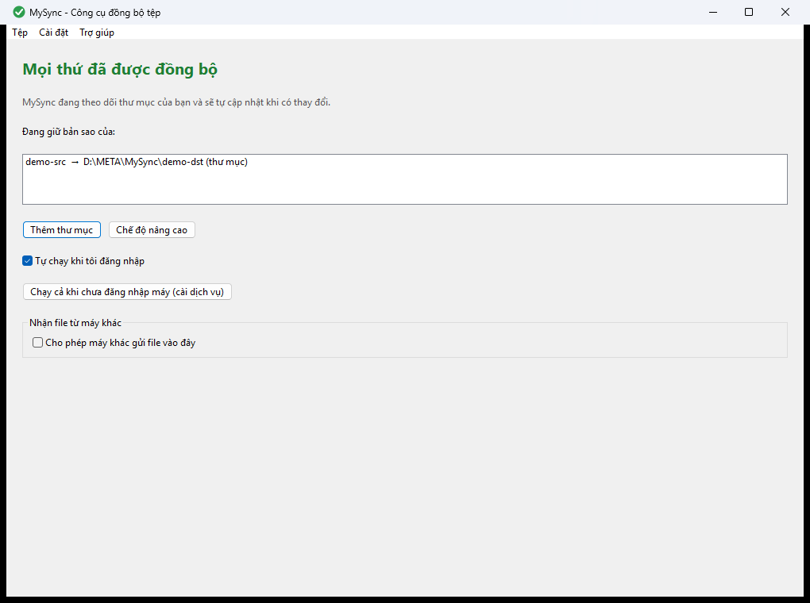

# MySync (C++)

Đồng bộ tệp nhanh, an toàn, chạy trên **Windows và Linux** (C++17). Viết lại từ bản MySync C# (.NET/WinForms).

- Bản quyền (C) 2026 **META.vn** · Tác giả: **Nguyễn Đức Sơn**
- Giấy phép: **GPL-2.0-or-later** (xem `LICENSE`). Thư viện vendor đều tương thích GPLv2: Monocypher (BSD-2/CC0), BLAKE3 (CC0), LZ4 (BSD-2).

## Dùng nhanh cho người mới (giao diện đồ hoạ)
Không cần biết lập trình hay sửa tệp cấu hình. Chi tiết hơn và ảnh từng màn: `docs/GUI.md`.

### 1. Lấy và mở chương trình
MySync chưa có bản cài sẵn: bạn dựng từ mã nguồn một lần (cần CMake và trình biên dịch C++; xem mục "Build" bên dưới), sau đó mở tệp `mysync-gui`. Lần dựng đầu cần mạng và hơi lâu: nếu máy chưa có thư viện giao diện wxWidgets 3.2, CMake tự tải bản đã ghim về và dựng.
- **Windows**: `cmake -S . -B build-gui -DMYSYNC_BUILD_GUI=ON` rồi `cmake --build build-gui --target mysync-gui`. Mở `mysync-gui.exe` trong thư mục `build-gui` (với Visual Studio là `build-gui\Release`) bằng cách bấm đúp.
- **Linux**: cần thêm gói `libgtk-3-dev` (và `libwxgtk3.2-dev` nếu muốn dùng bản có sẵn trong hệ thống). Dựng bằng hai lệnh như trên, rồi chạy `build-gui/mysync-gui`.
Không cần quyền quản trị để dùng chế độ thường.

### 2. Lần đầu: Bắt đầu nhanh và 3 bước
Lần đầu mở, màn **Chào mừng đến với MySync** hiện hai lựa chọn: **Dùng ngay, không cần cài đặt (khuyên dùng)** và **Tôi đã có dịch vụ / cấu hình nâng cao**. Chọn lựa chọn đầu.



- **Bước 1 — "Thư mục nào cần được giữ bản sao?"**: bấm **Chọn thư mục…** hoặc kéo một thư mục từ cửa sổ quản lý tệp thả vào cửa sổ. Bấm **Tiếp theo**.
- **Bước 2 — "Bản sao sẽ được lưu ở đâu?"**: chọn **Một thư mục khác, ổ USB hoặc thư mục chia sẻ trong mạng**, hoặc **Một máy tính khác có cài MySync** (xem mục 4).
- **Bước 3 — "Sẵn sàng"**: đọc dòng tóm tắt, bấm **Bắt đầu đồng bộ**. Từ bước 2 trở đi có nút **Quay lại** để sửa lựa chọn trước; bước 1 có **Huỷ**.

Mặc định an toàn: bỏ qua tệp tạm và tệp hệ thống, tệp bị xoá hoặc ghi đè được cất vào thùng rác của nơi lưu, không giới hạn tốc độ, cập nhật ngay khi có thay đổi.

### 3. Đồng bộ sang thư mục khác, ổ USB hoặc thư mục chia sẻ trong mạng
Ở bước 2, chọn thư mục đích (ví dụ `E:\Sao-luu`). Thư mục chia sẻ trong mạng gõ dạng `\\tên-máy\tên-chia-sẻ` (hai dấu gạch chéo ngược ở đầu). Nếu hiện lỗi "Không tìm thấy nơi lưu này", hãy kiểm tra ổ USB đã cắm chưa hoặc đường dẫn mạng có đúng không.

### 4. Ghép hai máy bằng mã
1. **Máy nhận**: ở màn nhận file, bật công tắc **Cho phép máy khác gửi file vào đây**, rồi bấm **Sao chép** ở dòng **Mã ghép**. Mã bắt đầu bằng `MSY1-`, **chỉ dùng được một lần và hết hạn sau khoảng 10 phút**; hết hạn thì bấm **Tạo mã mới**.
2. **Máy gửi**: ở bước 2 chọn **Một máy tính khác có cài MySync**, dán mã vào ô, bấm **Gửi yêu cầu ghép**.
3. Hai máy cùng hiện một **chuỗi xác nhận**. Kiểm tra giống hệt nhau, rồi ở máy nhận bấm **Đồng ý** (không giống hoặc không biết máy nào thì bấm **Từ chối**).
4. Nếu máy gửi không nối được, tường lửa của máy nhận có thể đang chặn: khi Windows hỏi có cho MySync truy cập mạng không, chọn **Cho phép**.



### 5. Đọc màn Trạng thái
Câu lớn ở giữa cho biết tình hình: "Đang đồng bộ … tệp…", "Mọi thứ đã được đồng bộ", hoặc "Có lỗi: …" (nguyên văn nguyên nhân).



Màu biểu tượng ở khay hệ thống: xám = chưa nối được với bộ đồng bộ; xanh lá = rảnh, mọi thứ đã xong; xanh dương = đang chép; vàng = cần chú ý; đỏ = có lỗi gần đây. Băng **đỏ** là lỗi làm việc không chạy được (đọc nguyên văn, sửa theo đó, thường là đường dẫn hoặc quyền); băng **hổ phách** là cảnh báo không chặn (ví dụ chưa nối được tới nơi lưu, MySync tự thử lại). Nút **Thêm thư mục** để đồng bộ thêm một thư mục. Đóng cửa sổ chỉ thu xuống khay; **Thoát hẳn** ở menu khay mới dừng đồng bộ.

### 6. Tự chạy khi đăng nhập, và chạy cả khi chưa đăng nhập
- **Tự chạy khi tôi đăng nhập** (công tắc ở màn Trạng thái, bật mặc định): MySync tự mở khi bạn đăng nhập máy. Không cần quyền quản trị.
- **Chạy cả khi chưa đăng nhập máy (cài dịch vụ)**: để MySync chạy nền kể cả sau khi khởi động lại mà chưa ai đăng nhập. Cần một người quản trị cấp phép cài (hộp xin phép của Windows hoặc `pkexec` trên Linux) nhưng dịch vụ chạy bằng **tài khoản của bạn** chứ không bằng tài khoản người quản trị cấp phép: nếu bạn dùng tài khoản thường, quản trị viên chỉ cấp phép cài. Trên Windows phần đồng bộ của dịch vụ chạy với quyền hạn chế (đã bỏ các nhóm quản trị và quyền nguy hiểm khỏi quyền truy cập máy này). Lưu ý: quyền hạn chế này không cô lập danh tính khi truy cập qua mạng (ví dụ thư mục chia sẻ), nên MySync từ chối cài dịch vụ cho tài khoản mà Windows không lọc quyền khi truy cập qua mạng hoặc có nhóm/quyền mạnh (tài khoản Administrator gốc, tài khoản miền thuộc nhóm quản trị, tài khoản thuộc các nhóm toán tử, máy đã tắt UAC hoặc đặt `LocalAccountTokenFilterPolicy`); MySync báo rõ lý do và gợi ý dùng "Tự chạy khi tôi đăng nhập". Trên Windows MySync hỏi **mật khẩu tài khoản** của bạn một lần (với tài khoản Microsoft đó là mật khẩu tài khoản Microsoft, **không phải mã PIN Windows Hello**). Khi bạn đổi mật khẩu Windows, dịch vụ không đăng nhập được nữa và màn Trạng thái hiện băng nhắc kèm nút **Cập nhật mật khẩu**. Tài khoản không có mật khẩu thì Windows không cho chạy dịch vụ: hãy dùng "Tự chạy khi tôi đăng nhập". Muốn quay lại: **Quay lại chạy dưới tài khoản của tôi**.

### 7. Chế độ nâng cao
Nút **Chế độ nâng cao** hiện bốn tab (Trạng thái, Cấu hình, Dịch vụ, Ghép máy và Khoá) cho người đã quen: xem `docs/GUI.md`.

### 8. Hỏi nhanh
- **Tệp bị xoá/ghi đè nằm đâu?** Không mất ngay: bản cũ được cất vào thư mục `__sync/__trash` ngay trong nơi lưu, chia theo giờ xoá.
- **Máy kia tắt thì sao?** MySync báo "Chưa nối được tới nơi lưu…" và tự thử lại; khi máy kia bật lại, phần bị lỡ được đồng bộ bù.
- **Gỡ một máy đã ghép?** Dùng chế độ nâng cao, tab Ghép máy và Khoá (danh sách máy được phép), hoặc dòng lệnh `mysync peer revoke <tên>` (xem `docs/SERVER-TO-SERVER.md`); phiên đang mở của máy đó bị ngắt ngay.

## Điểm chính
- **Watch realtime**: ReadDirectoryChangesW (Windows) / inotify (Linux), gộp sự kiện theo từng tệp (mặc định 300 ms), chờ tệp hết bị khoá, tràn hàng đợi thì quét lại, quét toàn bộ định kỳ để dự phòng.
- **Nhanh**: so size+mtime trước, chỉ băm BLAKE3 khi khác; chỉ mục hash lưu ra đĩa; tệp trùng nội dung không truyền; delta theo khối kiểu rsync cho tệp lớn sửa một phần; nén LZ4 (bỏ qua đuôi đã nén); nhiều kết nối song song, gửi OFFER theo lô không chờ từng tệp.
- **Bảo mật**: kênh Noise_IK (X25519 + XChaCha20-Poly1305 + BLAKE2b) với khoá công khai ghim sẵn hai chiều, allowlist client + quyền ro/rw + thư mục con, chặn path traversal, ghi tệp tạm → kiểm BLAKE3 → rename nguyên tử, xoá thì chuyển vào `__sync/__trash`, không log khoá. Chi tiết và giới hạn: `docs/DESIGN.md`.
- **Đích**: máy chủ MySync qua mạng, hoặc **copy trực tiếp** sang ổ/thư mục khác, UNC `\\server\share`, điểm mount CIFS/NFS.
- **Chạy**: độc lập (foreground) hoặc dịch vụ (Windows Service / systemd). Một binary `mysync`.

## Build (một lệnh)
```
cmake -S . -B build && cmake --build build && ctest --test-dir build
```
Cần CMake >= 3.16 và trình biên dịch C++17 (MSVC, MinGW-w64 g++, GCC, Clang). Không phụ thuộc thư viện ngoài (đã vendor trong `third_party/`).

## Dùng nhanh
```
mysync keygen -o server.key                  # in khoá công khai
mysync run -c server.toml                    # máy chủ
mysync run -c client.toml [--once]           # máy khách, theo dõi liên tục hoặc một lượt
mysync service install -c server.toml        # cài dịch vụ (admin/root)
```
Ghép máy, cấu hình mẫu và dịch vụ: `docs/SETUP.md`, `docs/SERVICE.md`, `examples/`.

## Cài làm dịch vụ (từng bước)

> **Lưu ý trung thực:** việc cài dịch vụ thật (Windows SCM, systemd) **chưa được kiểm trên máy thật** (xem `docs/STATUS.md`).
> Đã kiểm: sinh tham số/unit, kiểm tên dịch vụ, chặn chèn lệnh, biên dịch. Hãy thử trên máy thử trước khi triển khai.
> Chi tiết quyền và hành vi: `docs/SERVICE.md`.

**Bước 0 — ghép máy chủ với máy khách (làm một lần):**
1. Trên mỗi máy: `mysync keygen -o <tên>.key`. Lệnh in ra **khoá công khai** (64 ký tự hex); khoá bí mật nằm trong tệp, không gửi đi đâu.
2. Máy chủ: dán khoá công khai của máy khách vào `server.toml`: `[[client]]` → `public_key = "..."`, `access = "rw"` hoặc `"ro"`.
3. Máy khách: dán khoá công khai của máy chủ vào `client.toml`: `[[watch.target]]` → `server_key = "..."`; `key_file` trỏ tới khoá bí mật của chính máy khách.
4. Kiểm thử foreground trước khi cài: `mysync run -c server.toml`, rồi `mysync run -c client.toml --once`.
5. Trong cấu hình đặt **đường dẫn tuyệt đối** và `log_file` (không đặt thì log chỉ ra stderr; dịch vụ Windows sẽ không có log).
Mẫu: `examples/server.toml`, `examples/client.toml`; từng bước ghép máy: `docs/SETUP.md`.

**Windows** (PowerShell/CMD chạy bằng *Run as administrator*; tên dịch vụ mặc định `mysync-server` / `mysync-client`, đổi bằng `--name`):
```
mysync service install   -c C:\mysync\server.toml     # vai trò (server/client) tự nhận từ cấu hình
mysync service start     -c C:\mysync\server.toml
mysync service stop      -c C:\mysync\server.toml
mysync service uninstall -c C:\mysync\server.toml
```
- Dịch vụ chạy bằng tài khoản **`NT AUTHORITY\LocalService`** (đặc quyền thấp); đổi bằng `--user`. Khởi động tự động (trễ), tự chạy lại khi lỗi.
- LocalService phải được cấp quyền trước, ví dụ: `icacls "D:\data" /grant "NT AUTHORITY\LocalService:(OI)(CI)M"` cho thư mục đồng bộ, `state_dir` và thư mục log; tệp khoá chỉ cho LocalService đọc.
- Log: tệp ở `log_file` trong cấu hình. Trạng thái: `sc query mysync-server` hoặc `services.msc`.

**Linux** (systemd, chạy bằng root):
```
useradd --system --no-create-home --shell /usr/sbin/nologin mysync
install -m 0755 build/mysync /usr/local/bin/mysync
install -d -o mysync -g mysync /srv/mysync /var/lib/mysync /var/log/mysync /etc/mysync
install -m 0600 -o mysync -g mysync server.key /etc/mysync/server.key     # khoá bí mật: chế độ 0600, chủ là user dịch vụ
install -m 0640 -o root -g mysync server.toml /etc/mysync/server.toml
mysync service install -c /etc/mysync/server.toml --user mysync          # sinh /etc/systemd/system/mysync-server.service
systemctl enable --now mysync-server
```
Hoặc chép tay `examples/mysync.service` vào `/etc/systemd/system/` rồi `systemctl daemon-reload && systemctl enable --now mysync` (cách này tên dịch vụ là `mysync`, **không phải** `mysync-server`; các lệnh trạng thái/log/gỡ bên dưới phải dùng đúng tên bạn cài). Lưu ý `mysync service install` chỉ cài và `enable`, **không tự chạy**: cần `systemctl start` hoặc `enable --now`. Thư mục cần **ghi** phải nằm trong `ReadWritePaths` (lệnh `service install` tự thêm từ cấu hình).
- Trạng thái: `systemctl status mysync-server`. Log: `journalctl -u mysync-server -f` (stderr được journald thu).
- Gỡ: `systemctl disable --now mysync-server && mysync service uninstall -c /etc/mysync/server.toml`.

## Giao diện đồ hoạ (tuỳ chọn)
`mysync-gui` (wxWidgets 3.2, Windows + Linux GTK3) là binary riêng, mặc định **không** dựng để lõi vẫn build một lệnh:
```
cmake -S . -B build-gui -DMYSYNC_BUILD_GUI=ON && cmake --build build-gui --target mysync-gui
```
Bốn tab: **Trạng thái** (kèm icon khay đổi màu), **Cấu hình** (sửa không cần mở TOML), **Dịch vụ** (cài/gỡ/start/stop, tự nâng quyền UAC/pkexec), **Ghép máy và Khoá**. GUI nói chuyện với daemon qua kênh cục bộ (named pipe/Unix socket, có phân quyền), không mở cổng TCP và không đưa khoá bí mật qua kênh. Chi tiết, hạn chế: `docs/GUI.md`, `docs/GUI-CORE.md`.

## Tài liệu
- `docs/FEATURES.md` — bảng đối chiếu tính năng cũ → mới (giữ / đổi / bỏ, kèm lý do)
- `docs/DESIGN.md` — kiến trúc, giao thức
- `docs/SETUP.md`, `docs/SERVICE.md` — triển khai
- `docs/SERVER-TO-SERVER.md` — đồng bộ giữa các máy chủ bằng dòng lệnh: `peer add/remove/revoke`, `peers.d`, xoay khoá không gián đoạn, `status --json`, `health`, Ansible
- `docs/SERVER-TO-SERVER.md` — ghép/vận hành giữa các máy chủ bằng CLI (peer, peers.d, xoay khoá, thu hồi, health)
- `docs/GUI.md`, `docs/GUI-CORE.md` — giao diện đồ hoạ và kênh điều khiển cục bộ
- `docs/STATUS.md` — đã kiểm gì, chưa kiểm gì, hạn chế đã biết
